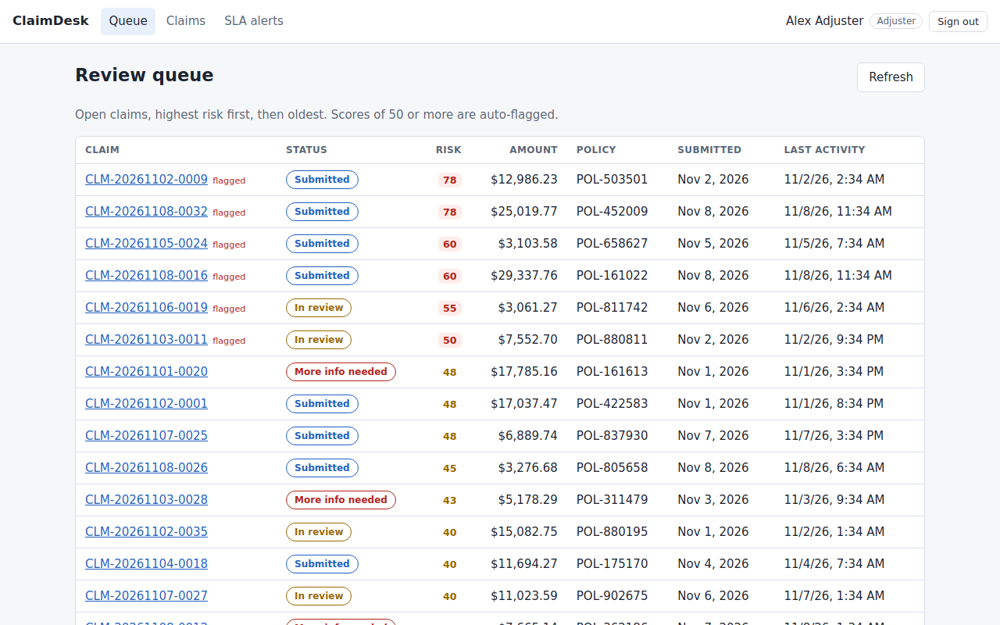
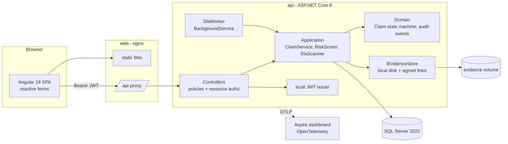
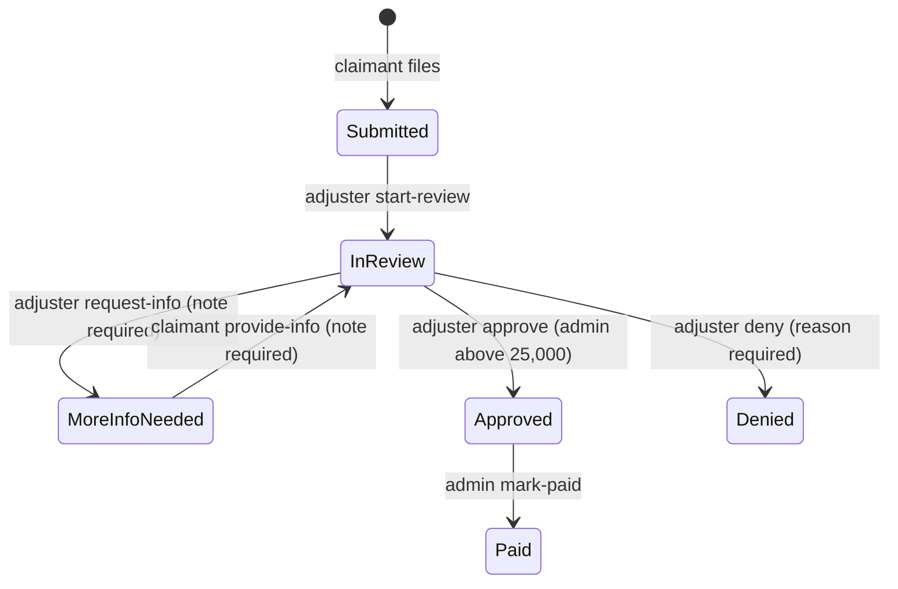
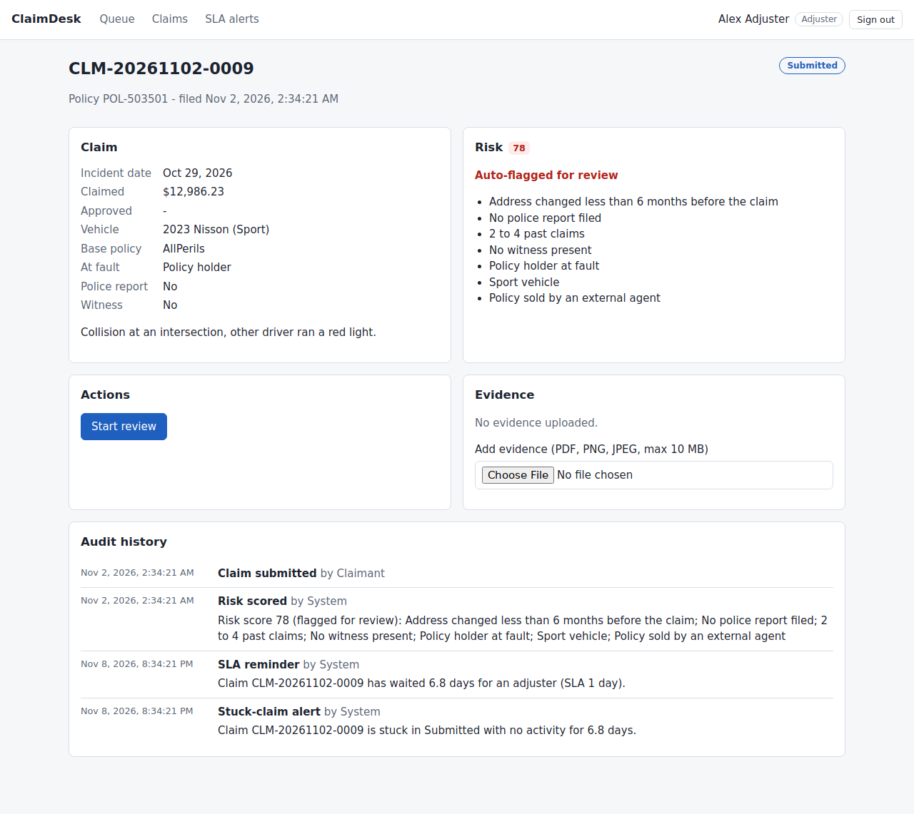
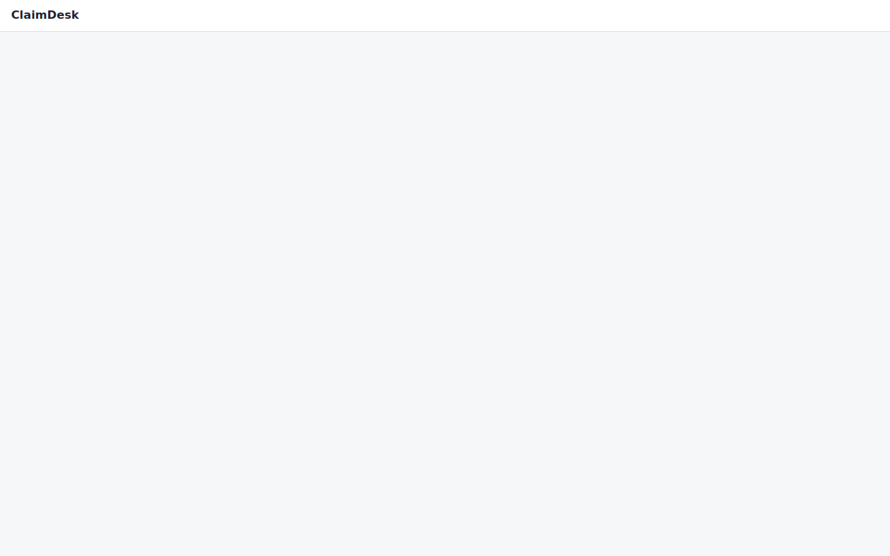

# ClaimDesk

[](https://github.com/Vrajesh-works/ClaimDesk/actions/workflows/ci.yml)

ClaimDesk is an insurance claims workflow portal. A policy holder files an auto claim and uploads
evidence, an adjuster works a queue ordered by fraud risk, and an admin approves large payouts and
marks claims paid. Each claim moves through a state machine owned by the domain layer, and every
step writes an append-only audit event. Claimant, adjuster and admin access goes through
policy-based and resource-based authorization, with a test for every endpoint. A background
worker raises SLA reminders and stuck-claim alerts. It is built with .NET 8, ASP.NET Core, EF Core,
SQL Server and Angular 18, and runs locally with one command. Each Azure service from the original
design sits behind an interface, so the cloud version only needs new adapters.



## Architecture



The solution is layered (Domain, Application, Infrastructure, Api), and dependencies point
inward. [docs/PLAN.md](docs/PLAN.md) has the data model, the state machine diagram, the risk rule
table and the API surface. [docs/PRODUCT.md](docs/PRODUCT.md) covers the problem, users and success
metrics.

### Claim lifecycle



`ClaimWorkflow` holds the transition table as data. The API uses it to enforce transitions, and
the claim detail endpoint returns `availableActions` from the same table, so the Angular buttons
cannot drift from the server rules.

## Quick start

### Everything in containers (one command)

```bash
docker compose up --build        # or: make up
```

| URL | What |
| --- | --- |
| http://localhost:8080 | Portal (nginx serving Angular, proxying `/api`) |
| http://localhost:5080/health/ready | API readiness |
| http://localhost:18888 | Aspire dashboard (traces and metrics) |

Demo accounts (password `ClaimDesk!2026`):

| Email | Role |
| --- | --- |
| `claimant@claimdesk.local` | Claimant |
| `claimant2@claimdesk.local` | Claimant (used to show claimants cannot see each other's claims) |
| `adjuster@claimdesk.local` | Adjuster |
| `admin@claimdesk.local` | Admin |

On startup the API applies EF Core migrations to SQL Server. It then seeds 40 synthetic claims
whose fields follow the Kaggle vehicle-claim columns, spread across every status.

### Without Docker (SQLite, fastest dev loop)

Needs the .NET 8 SDK and Node 20+.

```bash
make dev-api       # API on :5080, SQLite file, demo data
make web-install
make dev-web       # Angular on :4200, proxies /api to :5080
```

### Seeding from the real Kaggle data

The [Vehicle Claim Fraud Detection](https://www.kaggle.com/datasets/shivamb/vehicle-claim-fraud-detection)
CSV needs a Kaggle login, so it is not committed. Download `fraud_oracle.csv` and set
`Seed__KaggleCsvPath=/path/to/fraud_oracle.csv`. The seeder then imports up to `Seed__KaggleMaxRows`
rows (300 by default) in place of the synthetic claims. `tools/sample/fraud_oracle_sample.csv` has
the same columns for tests. To check the rule weights against the labels, run
`python3 tools/fraud_lift.py fraud_oracle.csv`. It prints the fraud rate and lift for every
category a rule uses.

## Tests

| Suite | Command | What it covers |
| --- | --- | --- |
| .NET unit (65) | `make test-unit` | State machine and role rules, risk scoring, evidence signature checks, SLA scanner thresholds, signed-link expiry |
| .NET integration (126) | `make test-integration` | Every endpoint x every role (a discovery test fails if a new endpoint is missing from the matrix), lifecycle over HTTP, append-only audit, evidence validation, seeding, migrations and lifecycle on real SQL Server 2022 via Testcontainers |
| Angular unit (10) | `make web-test` | Bearer interceptor and sign-out on 401, role guard, claim form validators, evidence checks |
| Playwright E2E (7) | `make e2e` | The full lifecycle through the UI across three roles: file with evidence, rejected file types, cross-claimant access denied, start review, request info, provide info, approve, mark paid, audit history |
| Compose smoke | CI only | Images build, the stack becomes healthy, login and the risk queue work through nginx |

`make e2e` starts its own API on a throwaway SQLite database plus `ng serve`. To run the same
tests against a running stack instead, set `E2E_BASE_URL=http://localhost:8080`.

CI (`.github/workflows/ci.yml`) runs on every pull request and on pushes to `main`. It runs
`dotnet format` as the lint step, then a warnings-as-errors build, both .NET suites, the Angular
build (strict templates) and unit tests, the Playwright E2E and the Compose smoke test.

## Design notes

- **Authorization in layers.** Named policies (`Claimant`, `Staff`, `Admin`, `AnyRole`) guard each
  endpoint, and the fallback policy denies anything without one. A resource handler
  (`ClaimAccessHandler`) restricts claimants to their own claims. The domain separately rejects
  transitions the role is not allowed to make. The Angular guards only hide navigation.
- **Entra ID ready.** The local JWT puts roles in the `roles` claim, which is where Entra ID puts
  app roles. Moving to Entra ID means swapping `AddJwtBearer` for `AddMicrosoftIdentityWebApi` and
  the login form for MSAL. The policies and their tests do not change.
- **Evidence is checked by content.** Uploads must be PDF, PNG or JPEG and at most 10 MB. The
  first bytes must match the extension, and the client's declared content type is ignored.
  Downloads go through short-lived HMAC-signed links, the local equivalent of a Blob SAS URL.
- **Explainable risk.** Weighted rules over Kaggle columns produce a 0-100 score and a list of
  reasons. A score of 50 or more auto-flags the claim. The queue sorts by score, then by age.
- **SLA worker.** A `BackgroundService` runs `SlaScanner` on an interval. It raises reminders for
  unpicked submitted claims and alerts for open claims with no activity. Repeat alerts are
  rate-limited, and each one goes into both the audit trail and the notification feed.
- **Optimistic concurrency.** Claims carry a version token, so two adjusters acting on the same
  claim get a 409 instead of silently overwriting each other.
- **Telemetry.** OpenTelemetry traces and metrics, including a custom `ClaimDesk` meter, go to the
  Aspire dashboard locally. In Azure the exporter would point at Application Insights.

| Claim detail | Login |
| --- | --- |
|  |  |

## What broke and how I fixed it

- **Evidence uploads threw a concurrency exception.** `Evidence` has a client-generated `Guid` key.
  EF Core only discovered new evidence rows through the claim's navigation collection, assumed
  they already existed, and issued an `UPDATE` that matched zero rows. The fix registers new
  evidence explicitly with `db.Evidence.Add(...)` before saving (commit `3bc9557`).
- **A failed upload after filing could duplicate claims.** The claim form files the claim first,
  then uploads the attachments. If an upload failed, the user stayed on the form, and submitting
  again would file a second claim. Now the form always moves to the new claim and shows the
  upload error there.
- **Claim detail did not reload when the route changed.** Angular reuses the component when only
  the `:id` changes, so a one-time `ngOnInit` load showed the previous claim. Loading now happens
  in `ngOnChanges`, driven by the bound `id` input.
- **The .NET SDK crashed on WSL with "Couldn't find a valid ICU package".** The machine had no
  libicu, and I had no root access. I unpacked the ICU `.deb` into a user directory and pointed
  `LD_LIBRARY_PATH` at it. I did not use invariant globalization, because currency formatting and
  culture-aware comparisons would silently change.
- **Playwright's Chromium would not start locally because `libnss3.so` was missing.** I used the
  same fix: unpacked the NSS, NSPR and ALSA `.deb`s user-level. CI uses
  `playwright install --with-deps`. `playwright.config.ts` accepts `PW_CHROMIUM_PATH` for machines
  with their own Chromium.
- **The API image failed to build in CI even though every other build passed.** The image build
  reported CA1848 and CA1861 analyzer errors that `dotnet build` never showed. The Dockerfile
  copied `Directory.Build.props` (warnings as errors, latest analyzers) but not `.editorconfig`,
  which turns those rules off for logging calls and generated migrations. Inside the image the
  analyzers ran at full strength. Copying `.editorconfig` into the build stage fixed it. I
  reproduced both outcomes by publishing from a copy of the exact Docker build context.
- **The Docker CLI disappeared after a reboot, but the Docker socket stayed.** Testcontainers talks
  to the socket directly, so the SQL Server integration test kept running locally. The Compose
  smoke test runs in CI.

## Roadmap (deferred, designed for)

Cloud was out of scope for this build. Each item below has a seam in the code. Details are in
[docs/PLAN.md](docs/PLAN.md#future-work).

- Azure SQL Database in place of the SQL Server container (connection string change).
- Azure Blob Storage `BlobEvidenceStore` with user-delegation SAS URLs, plus Defender for Storage
  malware scanning.
- Microsoft Entra ID (OAuth 2.0 / OIDC) with `Microsoft.Identity.Web` and MSAL Angular.
- Application Insights through the Azure Monitor OpenTelemetry exporter.
- Azure App Service or Container Apps, infrastructure as code in Bicep or Terraform, and deploys
  from CI with a live link.
- Key Vault for signing keys and connection strings.
- Elsa Workflows for configurable SLA timers, email notifications, and an ML fraud score next to
  the rules.

## Built with / inspired by

- [jasontaylordev/CleanArchitecture](https://github.com/jasontaylordev/CleanArchitecture) - design
  reference for the layered Domain / Application / Infrastructure / Api solution and the Angular
  front end next to an ASP.NET Core API. The code here is my own, written in that style. No
  template code was copied.
- [dotnet/eShop](https://github.com/dotnet/eShop) - design reference for service boundaries, health
  checks and OpenTelemetry with the Aspire dashboard.
- [Elsa Workflows](https://github.com/elsa-workflows/elsa-core) - design reference for modelling
  long-running workflows and timers. ClaimDesk uses its own small state machine and a hosted SLA
  worker instead.
- [Vehicle Claim Fraud Detection (Kaggle)](https://www.kaggle.com/datasets/shivamb/vehicle-claim-fraud-detection) -
  the column shapes behind the risk rules and seed data, and the labels used to calibrate the rule
  weights with `tools/fraud_lift.py`.
- .NET 8, ASP.NET Core, EF Core, SQL Server 2022, Angular 18, xUnit, Testcontainers, Playwright,
  OpenTelemetry, nginx.

## License

[MIT](LICENSE)
