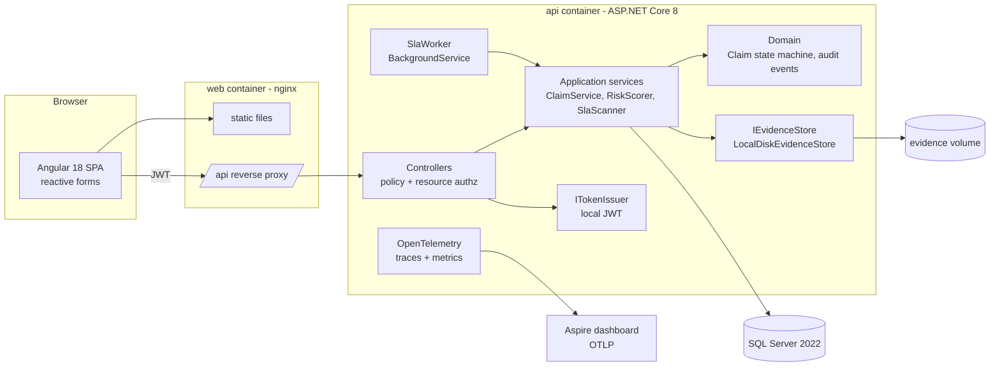
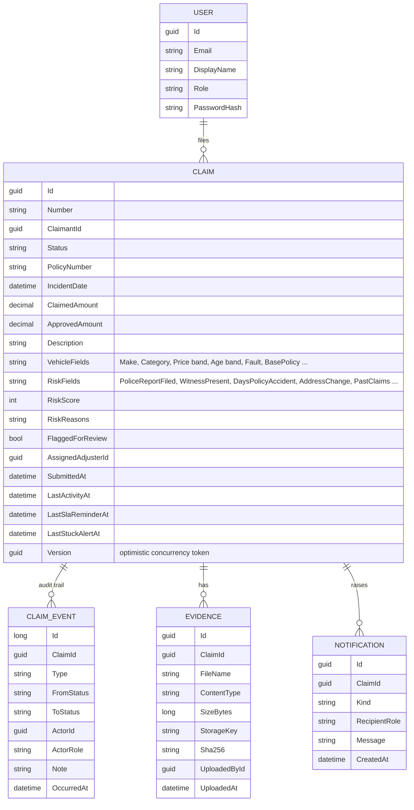
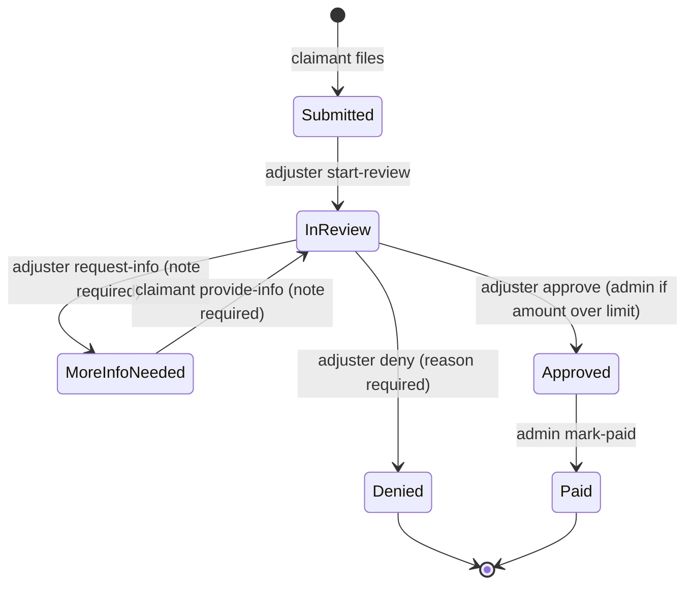

# ClaimDesk - Technical Plan

## Architecture

A layered ASP.NET Core solution (Domain, Application, Infrastructure, Api) in the style of
Clean Architecture, an Angular 18 single-page app, and SQL Server, all run locally with Docker
Compose. Every Azure dependency from the roadmap sits behind an interface with a local
implementation, so moving to Azure is an adapter change rather than a rewrite.

### Cloud swap points

| Local today | Interface / seam | Azure later |
| --- | --- | --- |
| SQL Server 2022 container | EF Core `ClaimDeskDbContext`, connection string | Azure SQL Database |
| `LocalDiskEvidenceStore` + HMAC-signed download links | `IEvidenceStore` (`SaveAsync`, `OpenReadAsync`, `CreateReadUrl`) | `BlobEvidenceStore` with user-delegation SAS URLs |
| Local JWT issuer, symmetric key, `roles` claim | JWT bearer + policies `Claimant`, `Adjuster`, `Admin` | Microsoft Entra ID app roles via `Microsoft.Identity.Web`; policies unchanged |
| OpenTelemetry OTLP to Aspire dashboard | `AddOpenTelemetry()` | Azure Monitor exporter / Application Insights |
| `ILogger` notification sink + notifications table | `INotificationSink` | Azure Communication Services email, Service Bus |
| Docker Compose | Dockerfile per service | App Service / Container Apps via Bicep, deploy from CI |

The local JWT already uses the `roles` claim type that Entra ID emits for app roles, so the
authorization policies and their tests do not change when the identity provider does.

## Data model

### Claim state machine

The transition table lives in the domain (`ClaimWorkflow`), lists the role allowed for each
action, and is the single source of truth for both the API and the Angular action buttons.

### Risk rules

Weighted, explainable rules over Kaggle-shaped fields. Score is capped at 100; a claim is
auto-flagged for review at 50 or above. Each fired rule is stored as a reason string.

| Rule | Kaggle column | Weight |
| --- | --- | --- |
| Policy started 0-7 days before accident | `Days_Policy_Accident` | 25 |
| Address changed under 6 months before claim | `AddressChange_Claim` | 20 |
| No police report | `PoliceReportFiled` | 15 |
| More than 4 past claims (2-4: 8) | `PastNumberOfClaims` | 15 |
| No witness | `WitnessPresent` | 10 |
| Policy holder at fault | `Fault` | 10 |
| Sport vehicle | `VehicleCategory` | 10 |
| Claimed amount over 20,000 | (claim amount) | 10 |
| External agent | `AgentType` | 5 |

The weights are starting assumptions. `tools/fraud_lift.py` computes the fraud rate per category
from the real CSV so the weights can be recalibrated against `FraudFound_P`.

## API surface

| Method | Route | Allowed |
| --- | --- | --- |
| POST | `/api/auth/login` | anonymous |
| GET | `/api/auth/me` | any authenticated |
| POST | `/api/claims` | claimant |
| GET | `/api/claims` | claimant (own), adjuster, admin |
| GET | `/api/claims/{id}` | owner claimant, adjuster, admin |
| GET | `/api/claims/{id}/history` | owner claimant, adjuster, admin |
| POST | `/api/claims/{id}/start-review` | adjuster, admin |
| POST | `/api/claims/{id}/request-info` | adjuster, admin |
| POST | `/api/claims/{id}/provide-info` | owner claimant |
| POST | `/api/claims/{id}/approve` | adjuster, admin (admin above limit) |
| POST | `/api/claims/{id}/deny` | adjuster, admin |
| POST | `/api/claims/{id}/mark-paid` | admin |
| POST | `/api/claims/{id}/evidence` | owner claimant, adjuster |
| GET | `/api/claims/{id}/evidence` | owner claimant, adjuster, admin |
| GET | `/api/claims/{id}/evidence/{evidenceId}/link` | owner claimant, adjuster, admin |
| GET | `/api/evidence/download?token=` | anonymous, signed token |
| GET | `/api/queue` | adjuster, admin |
| GET | `/api/notifications` | adjuster, admin |
| GET | `/api/admin/users` | admin |
| GET | `/health/live`, `/health/ready` | anonymous |

## Milestones (today)

1. Docs: product doc and this plan.
2. Solution skeleton, domain model, state machine, risk rules, unit tests.
3. EF Core persistence, SQL Server migrations, seeding (synthetic Kaggle-shaped claims, optional
   real CSV import).
4. API: JWT auth, policies, resource-based authorization, claim and evidence endpoints, queue,
   notifications, health checks, OpenTelemetry.
5. SLA background worker.
6. Integration tests: authorization matrix for every endpoint, lifecycle, evidence validation,
   SQL Server via Testcontainers.
7. Angular 18 portal with reactive forms.
8. Playwright E2E for the full lifecycle.
9. Dockerfiles, Docker Compose, Makefile, CI workflow, PR and issue templates, README.

## Test strategy

| Layer | Tool | What it proves |
| --- | --- | --- |
| Unit | xUnit, `FakeTimeProvider` | State machine transitions and role rules, risk scoring, evidence signature checks, SLA scanner thresholds, signed link expiry |
| Integration | xUnit + `WebApplicationFactory`, SQLite in-memory | Every endpoint x every role returns the expected status (authorization matrix), an endpoint-discovery test fails if a new endpoint is missing from the matrix, full lifecycle over HTTP, audit rows are append-only |
| Integration (real DB) | Testcontainers SQL Server | Migrations apply on SQL Server 2022 and the lifecycle works against it (runs in CI, skipped when Docker is absent) |
| E2E | Playwright (Chromium) | A claimant files a claim with evidence, an adjuster reviews and requests info, the claimant responds, the adjuster approves, the admin marks it paid, and the history shows every step |
| Smoke | Docker Compose in CI | Images build, the stack starts, `/health/ready` is healthy |

## Future work

Deferred cloud items (out of scope today, designed for):

- **Azure SQL Database** in place of the SQL Server container (connection string change, enable
  `EnableRetryOnFailure`).
- **Azure Blob Storage** `BlobEvidenceStore` with user-delegation SAS URLs in place of local disk
  and HMAC-signed links; malware scanning with Defender for Storage.
- **Microsoft Entra ID** (OAuth 2.0 / OIDC) via `Microsoft.Identity.Web` and MSAL Angular in place
  of the local JWT issuer and login form; app roles map to the existing policies.
- **Application Insights** via the Azure Monitor OpenTelemetry exporter.
- **Azure App Service or Container Apps** hosting, with infrastructure as code in **Bicep or
  Terraform** and **deploy from CI** (GitHub Actions or Azure DevOps) with a live link.
- **Key Vault** for the signing key and connection strings.

Other deferred items:

- Elsa Workflows for configurable SLA timers instead of the fixed-interval worker.
- Email notifications and adjuster assignment rules.
- ML fraud score trained on the Kaggle data alongside the explainable rules.
- Outbox pattern and integration events (eShop style) if claims are split into services.
